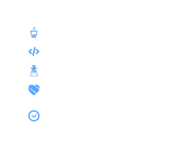

<h3>Hi. I'm Sebastian </h3>

> <em>On my way through the Fog of life</em>

I study applied computer science at HSMW and work part-time as a developer on the **HSMWmobil** project, focusing mainly on the backend and, when needed, on the app frontend.

 

 

  

**My interests and hobbies**

*cybersecurity* • *malware development* • *hack the box* • *minecraft* • *programming*

  

Also, I occasionally develop some game-related projects, as you will see below with my pinned repositories.